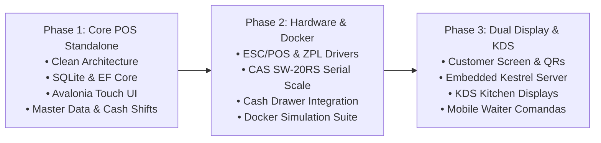

# Loqzen POS

> **Multiplatform Standalone Point of Sale (POS) & Kitchen Display System (KDS)**  
> Developed in **.NET 8/9** with **Avalonia UI**, operating under a 100% **Offline-First** paradigm with local **SQLite** persistence, hardware abstraction for real & emulated peripherals, and dual-screen customer display.

---

[](#-tech-stack)
[](#-tech-stack)
[](#-tech-stack)
[](#-hardware-simulation-docker)
[](#-project-structure)

---

## 📖 Table of Contents

- [Overview](#-overview)
- [Key Features](#-key-features)
- [Tech Stack](#-tech-stack)
- [Project Structure](#-project-structure)
- [Hardware & Peripheral Architecture](#-hardware--peripheral-architecture)
- [Hardware Simulation (Docker)](#-hardware-simulation-docker)
- [Architectural Principles & Rules](#-architectural-principles--rules)
- [Development Roadmap](#-development-roadmap)
- [Multi-Agent Team Orchestration](#-multi-agent-team-orchestration)
- [Getting Started](#-getting-started)
- [Documentation Index](#-documentation-index)

---

## 🌟 Overview

**Loqzen POS** is an enterprise-grade, standalone point of sale and local backoffice solution designed to run natively on **Windows, Linux, and Android**. 

Built with an **Offline-First** architecture, Loqzen POS operates with complete autonomy: it manages its own local catalog, pricing, taxes, customers, and transactions directly in a local SQLite database using the Outbox Pattern. When network connectivity is absent or unstable, operations continue seamlessly without latency or interruptions.

For restaurant and hospitality environments, Loqzen POS includes an embedded local web and WebSocket server (powered by Kestrel) that turns the main terminal into a master hub for mobile waiter handhelds (comanderas) and Kitchen Display System (KDS) screens over the local LAN.

---

## ✨ Key Features

- **100% Standalone & Autonomous**: Local administration of master records (products, categories, pricing, taxes, and customers). No mandatory external cloud or ERP dependency for sales operations.
- **Offline-First Resilience**: Transactions are instantly committed to local SQLite storage. An Outbox Pattern queues events for optional background synchronization.
- **Cross-Platform Touch UI**: Built with [Avalonia UI](https://avaloniaui.net/) using MVVM (`CommunityToolkit.Mvvm`). Optimized for touch interactions on 15.6" and 18.5" touchscreens (touch targets $\ge 48\times 48\text{ px}$).
- **Dual Screen Support**: Secondary dedicated customer display window showing real-time itemized basket, promotions, total amounts, and dynamic payment QR codes.
- **Comprehensive Hardware Integration**:
  - **Thermal Receipt & Kitchen Printing**: ESC/POS and ZPL drivers over TCP/IP (Port 9100) and USB.
  - **Cash Drawer**: Automatic solenoid pulse ejection via ESC/POS command (`0x1B 0x70`) routed through the printer RJ11/RJ12 port.
  - **Commercial Serial Scale**: Real-time continuous weight reading via RS-232 serial connection (`System.IO.Ports`) for CAS SW-20RS scales.
  - **Barcode Scanning**: USB HID keyboard emulation with global event hook listeners to avoid loss of focus.
- **Restaurant & Hospitality Extension (KDS & Comandas)**:
  - Embedded Kestrel HTTP/WebSocket server running inside the POS application.
  - Push notifications to kitchen station screens (Hot Kitchen, Cold, Bar) with time-based visual aging cues (< 5 min green, 5–15 min yellow, > 15 min red).
  - Multicast status updates back to waiter handhelds.
  - Automatic fallback to physical kitchen ticket printing if a KDS screen disconnects.
- **Delivery Integration Bridge**: Local bridge/webhook receiver for external delivery platforms (Uber Eats, Rappi) to inject orders directly into the local POS pipeline.

---

## 🛠 Tech Stack

| Layer | Technology | Purpose |
|---|---|---|
| **Platform / Runtime** | [.NET 8 / 9](https://dotnet.microsoft.com/) | High-performance, cross-platform runtime |
| **UI Framework** | [Avalonia UI 11.x](https://avaloniaui.net/) | Cross-platform XAML Desktop & Mobile UI |
| **MVVM Toolkit** | CommunityToolkit.Mvvm / ReactiveUI | MVVM architecture, observable properties, relay commands |
| **Local Persistence** | SQLite + Entity Framework Core | Offline-first relational data store with migrations |
| **Embedded Server** | ASP.NET Core Kestrel | Embedded LAN server for KDS WebSockets & Comandas |
| **Hardware I/O** | `System.IO.Ports`, Raw TCP Sockets, USB HID | Serial scales, network printers, barcode scanners |
| **Testing & Emulation** | Docker Compose (Python / Node.js / Alpine / socat) | Virtualized POS hardware environment for dev/CI |

---

## 📂 Project Structure

The project strictly follows **Clean Architecture** principles to isolate business rules from frameworks, UI, and physical hardware:

```text
loqzen-pos/
├── Docs/                          # Technical documentation & architecture specs
│   ├── Arquitectura_Docker_Emulacion_POS.md
│   ├── Especificacion_Tecnica_KDS_Comandas.md
│   ├── Especificacion_Tecnica_POS_Multiplataforma.md
│   ├── Hardware_POS_Seleccionado.md
│   ├── pos-prompt-antigravity.md
│   └── README.md
├── docker/                        # Hardware simulation environment
│   ├── docker-compose.yml         # Emulator topology (Printer, Scale, Delivery Mock)
│   └── emulator/
│       ├── printer/               # TCP 9100 ESC/POS simulator & cash drawer logger
│       ├── scale/                 # CAS SW-20RS serial weight stream via socat
│       └── webhook/               # Rappi / Uber Eats webhook mock server
├── src/
│   ├── Core.Domain/               # Pure Domain: Entities, Enums, Value Objects (UUIDs/Guids)
│   ├── Core.Application/          # Use Cases, CQRS/DTOs, Hardware Interfaces (IPrinterService, etc.)
│   ├── Infrastructure.Data/       # SQLite DbContext, EF Core mappings, Outbox Pattern
│   ├── Infrastructure.Hardware/   # Peripheral drivers (ESC/POS, ZPL, System.IO.Ports, USB HID)
│   ├── Presentation.Desktop/      # Avalonia UI app (Cashier touch UI, dual screen window)
│   └── Presentation.Server/       # Embedded Kestrel server for local LAN KDS & Comandas
├── .gitignore                     # Production-ready git ignore
└── README.md                      # Project master documentation
```

---

## 🔌 Hardware & Peripheral Architecture

### Selected Reference Hardware

| Device | Model | Interface / Protocol | Purpose |
|---|---|---|---|
| **POS Terminal** | Volcora POS Standard Plus (18.5") | Intel N97, USB, RS-232, Dual HDMI/VGA | Central cashier terminal & primary touch display |
| **Receipt Printer** | Epson TM-T20III / TM-T88VI | TCP/IP (Port 9100) / USB (ESC/POS) | Customer receipts & vouchers |
| **Kitchen Printer** | Epson / Zebra | TCP/IP or USB (ESC/POS & ZPL) | Physical kitchen preparation tickets |
| **Cash Drawer** | Volcora Heavy-Duty 16" | RJ11 / RJ12 via Printer DKD | Ejection triggered by pulse command (`0x1B 0x70`) |
| **Commercial Scale** | CAS SW-20RS (NTEP Certified) | RS-232 Serial (`System.IO.Ports`) | Continuous weigh-ins for weighed items |
| **Barcode Scanner** | 1D/2D Hands-free Scanner | USB HID (Keyboard emulation) | Instant product barcode lookup |
| **Customer Display** | Secondary 10.1"–15.6" Screen | HDMI / Extended Desktop | Live order breakdown and dynamic payment QR |

### Connection Diagram

```text
  [ Epson Thermal Printer ] <--- (TCP/IP 9100 or USB) --- [ Avalonia UI (.NET POS) ]
              |                                                   |
              +--- (RJ11/RJ12 Cable) ---> [ Volcora Cash Drawer ]  |
                                                                  +--- (RS-232 Serial) ---> [ CAS SW-20RS Scale ]
                                                                  |
                                                                  +--- (Secondary Display) -> [ Customer Screen ]
```

---

## 🐳 Hardware Simulation (Docker)

To allow development and automated testing without requiring physical POS peripherals attached, a Docker Compose simulation suite is provided:

```yaml
version: '3.8'

services:
  # 1. Shared SQLite storage volume
  pos-db-sync:
    image: alpine:latest
    container_name: pos-db-sync
    volumes:
      - ./data:/app/data

  # 2. Virtual Thermal Printer & Cash Drawer (TCP 9100)
  thermal-printer-emulator:
    build: ./emulator/printer
    container_name: thermal-printer-emulator
    ports:
      - "9100:9100"
    environment:
      - LOG_LEVEL=debug

  # 3. Virtual CAS SW-20RS Serial Scale (socat + Python stream)
  serial-scale-emulator:
    build: ./emulator/scale
    container_name: serial-scale-emulator
    devices:
      - "/dev/ptmx:/dev/ptmx"
    environment:
      - SCALE_MODEL=CAS-SW20RS
      - WEIGHT_STEP_SECONDS=3

  # 4. Delivery Webhook & Payment Gateway Mock (Rappi / Uber Eats)
  delivery-webhook-mock:
    image: node:18-alpine
    container_name: delivery-webhook-mock
    working_dir: /app
    volumes:
      - ./emulator/webhook:/app
    ports:
      - "5000:5000"
    command: ["node", "server.js"]
```

---

## 📐 Architectural Principles & Rules

1. **Clean Architecture Strictness**:
   - The UI (`Presentation.Desktop`) and Data/Hardware layers only depend inward on `Core.Application` and `Core.Domain`.
   - Business and pricing logic reside exclusively in `Core.Domain` and `Core.Application`.
2. **Universal UUIDs (Guids)**:
   - All master entities (`Product`, `Category`, `Customer`, `Tax`) and transaction records (`Order`, `OrderItem`, `Payment`, `CashShift`) use `Guid` primary keys to prevent collisions in distributed/offline nodes.
3. **Hardware Decoupling via Interfaces**:
   - Views and ViewModels must never invoke physical hardware directly.
   - All peripherals are injected through domain interfaces (`IPrinterService`, `IScaleService`, `IBarcodeScannerService`, `ICashDrawerService`), allowing transparent switching between real hardware and Docker emulators.
4. **Outbox Pattern for Resilience**:
   - Any transaction intended for eventual cloud synchronization is recorded into a local `OutboxMessages` table in SQLite during the same database transaction.

---

## 🗺 Development Roadmap



### Phase 1: Core POS Standalone & Local DB
- Establish Clean Architecture solution structure in .NET 8/9.
- Configure SQLite DbContext, Outbox table, and initial migrations.
- Implement touch-friendly cash register UI in Avalonia (catalog search, categories, cart management, split payments, cash open/close).

### Phase 2: Hardware Drivers & Emulation Environment
- Implement `IPrinterService` (ESC/POS formatting, paper cut, DKD cash drawer pulse `0x1B 0x70`, ZPL kitchen labels).
- Implement `IScaleService` reading continuous RS-232 serial weight frames (`ST,GS,+001.25kg\r\n`).
- Implement global USB HID barcode reader hook.
- Configure and launch Docker Compose emulation suite.

### Phase 3: Dual Screen & Restaurant KDS / Comandas
- Implement `CustomerDisplayWindow.axaml` for secondary customer-facing monitor.
- Embed Kestrel server in POS host for local LAN WebSocket communication.
- Implement KDS kitchen view with time-based visual status color tags.
- Implement mobile order dispatch and offline queue fallback.

---

## 🤖 Multi-Agent Team Orchestration

For development with multi-agent systems (e.g. Google Antigravity, Claude Code, or autonomous agent swarms), responsibilities are partitioned as follows:

| Role | Focus & Responsibilities | Key Deliverables |
|---|---|---|
| `@dotnet-backend-architect` | Domain modeling, Clean Architecture, SQLite persistence, EF Core, Outbox pattern. | Solution skeleton, `Core.Domain`, `Infrastructure.Data`, SQLite migrations. |
| `@ui-ux-frontend-architect` | Touchscreen UI/UX in Avalonia XAML, MVVM ViewModels, responsive layouts, numpads. | `CheckoutView.axaml`, `CustomerDisplayWindow.axaml`, tactile payment dialogs. |
| `@hardware-infrastructure-agent` | Peripheral drivers, raw socket/serial I/O, ESC/POS, ZPL, Docker Compose test suite. | `Infrastructure.Hardware`, `IPrinterService`, `IScaleService`, Docker emulators. |
| `@networking-kds-agent` | Embedded Kestrel server, WebSockets, mDNS LAN discovery, KDS protocol. | `Presentation.Server`, WebSocket handlers, KDS screen synchronization. |

---

## 🚀 Getting Started

### Prerequisites

- [.NET 8.0 SDK](https://dotnet.microsoft.com/download) or [.NET 9.0 SDK](https://dotnet.microsoft.com/download)
- [Docker & Docker Compose](https://www.docker.com/) (for hardware emulation)
- Git & [GitHub CLI (`gh`)](https://cli.github.com/)

### 1. Clone Repository

```bash
gh repo clone williamag929/loqzen-pos
cd loqzen-pos
```

### 2. Start Hardware Emulators (Docker)

```bash
docker compose -f docker/docker-compose.yml up -d
```

### 3. Build & Run POS Application

```bash
# Restore and build the Clean Architecture solution
dotnet build

# Run desktop presentation app
dotnet run --project src/Presentation.Desktop
```

---

## 📚 Documentation Index

All in-depth technical specifications are available in the [`Docs/`](file:///home/spatial/loqzen-pos/Docs) directory:

- [Technical Specification: Multiplatform POS (Offline-First)](file:///home/spatial/loqzen-pos/Docs/Especificacion_Tecnica_POS_Multiplataforma.md)
- [Technical Specification: Restaurant KDS & Mobile Comandas](file:///home/spatial/loqzen-pos/Docs/Especificacion_Tecnica_KDS_Comandas.md)
- [Docker Hardware Simulation Architecture](file:///home/spatial/loqzen-pos/Docs/Arquitectura_Docker_Emulacion_POS.md)
- [Selected POS Hardware Specifications](file:///home/spatial/loqzen-pos/Docs/Hardware_POS_Seleccionado.md)
- [Multi-Agent Master Initialization Prompt](file:///home/spatial/loqzen-pos/Docs/pos-prompt-antigravity.md)
- [AI Team Instructions & Project Guide](file:///home/spatial/loqzen-pos/Docs/README.md)

---

## 📄 License

Proprietary — All rights reserved © Loqzen POS.
